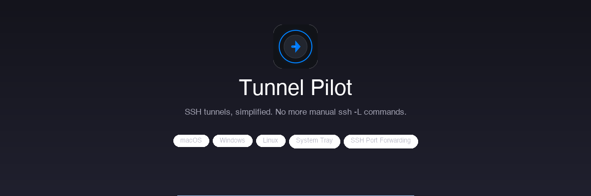
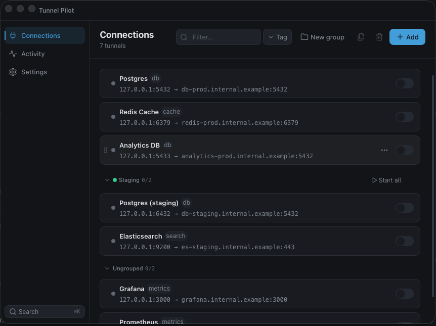
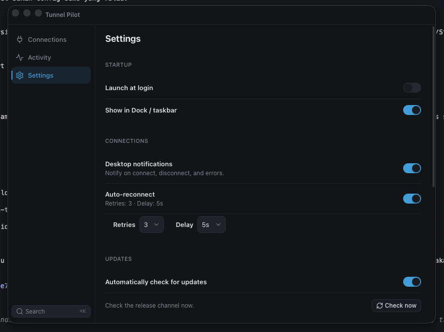
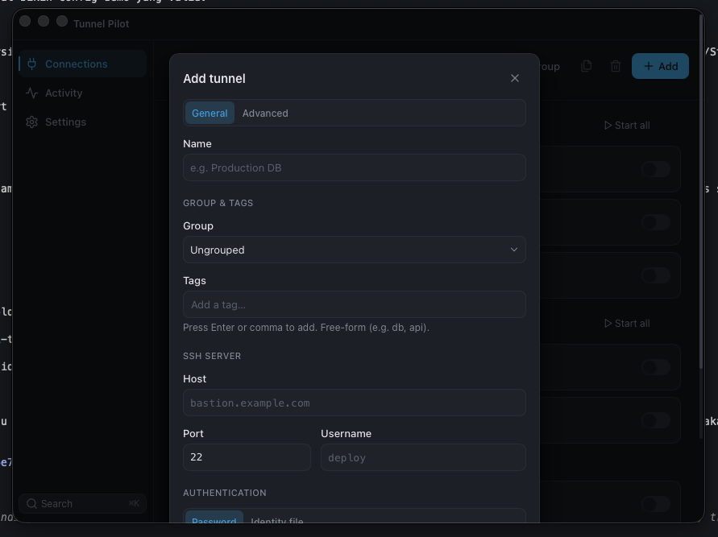
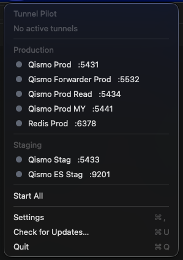
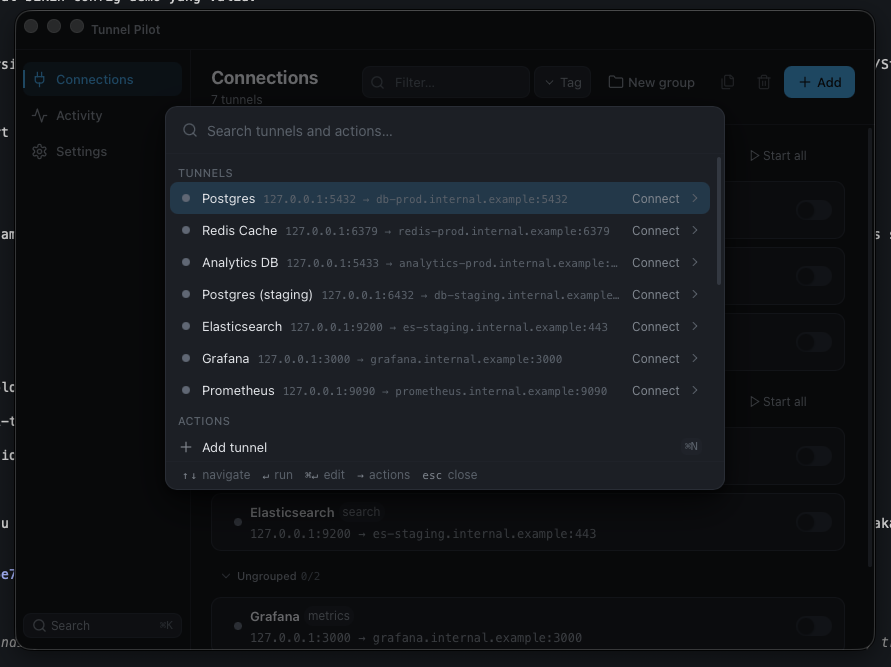

<p align="center">
  
</p>

<p align="center">
  <a href="https://github.com/kalfian/tunnel-pilot/releases/latest"></a>
  
  
  
  
  
  
</p>

<p align="center">
  <b>Website</b>: <a href="https://kalfian.github.io/tunnel-pilot">kalfian.github.io/tunnel-pilot</a>
</p>

**Tunnel Pilot is a free, open-source SSH tunnel manager and port forwarder.** Save your SSH local port forwards (`ssh -L`) once, then toggle them from the menu bar (macOS) or system tray (Windows, Linux) and let them reconnect on their own. For servers, homelabs and a Raspberry Pi there is **[Tunnel Pilot CLI](#tunnel-pilot-cli-server)**: the same features as a daemon you manage from the terminal or a browser-based web UI.

Manage your SSH tunnels with ease — toggle connections on/off directly from the tray menu, configure tunnels through a clean settings window, and get status at a glance. Tunnel Pilot lives entirely in the menu bar (macOS) or system tray (Windows/Linux) — no Dock icon by default.

> **Since 2.0, Tunnel Pilot is a full rewrite in Rust + Tauri v2** (version 1 was a Flutter app). The app now idles in roughly **15–30 MB of RAM** (down from ~100–200 MB on the Flutter v1 build), starts faster, and adds a ⌘K command palette, groups/tags, a resizable/responsive window, OS-keychain credential storage, and a **cryptographically signed self-updater**. See [Upgrading from v1](#upgrading-from-v1) — **your saved tunnels are preserved automatically.**

<p align="center">
  
  
  
</p>

<p align="center">
  
  
</p>

## Features

- **System Tray / Menu Bar** — Lives entirely in the menu bar (macOS) or system tray (Windows/Linux); dynamic tray icon shows the active connection count.
- **Quick Toggle** — Turn SSH tunnels on/off from the tray menu or the window with colored status indicators (connected / connecting / error / disconnected).
- **Full CRUD** — Add / edit / duplicate / delete tunnel configurations; drag to reorder or drag a tunnel between groups; edit from each row's actions.
- **Command Palette (⌘K)** — Fuzzy-search every action: connect/disconnect, jump to a view, toggle theme, check for updates, and more.
- **Groups & Tags** — Organize tunnels into collapsible groups and filter by tag; start/stop a whole group at once.
- **Password & Identity File Auth** — SSH password or identity file. Passwords are stored in your **OS keychain** (Keychain / Windows Credential Manager / Secret Service), with an owner-only (`0600`) local file as the fallback when no keychain is available (that file is plaintext — prefer identity files on such machines).
- **Host-Key Pinning** — Each tunnel pins its SSH server's host key on the first connection (and honours your `~/.ssh/known_hosts`, read-only). A changed key is refused — never retried automatically — and shown with both fingerprints until you verify and trust it, so an impostor server cannot receive your password or traffic.
- **Auto-Reconnect & Keep-Alive** — Configurable backoff, SSH keep-alive liveness, and wake-from-sleep recovery.
- **Backup & Restore** — Export/import configurations as JSON (passwords excluded for security; identity file paths included). Non-destructive **merge** or **replace** import.
- **Launch at Login** — Start Tunnel Pilot automatically when you log in.
- **Signed Auto-Updates** — Update bundles are **minisign-signed** and verified against a public key embedded in the app before install (see [Security & signing](#security--signing)).
- **Copy SSH Command** — Copy the equivalent `ssh -N -L …` command for any tunnel.
- **Logs Viewer** — In-memory activity log (last 500 entries) with copy/clear.
- **CLI / automation (macOS & Linux)** — Control the running app from a terminal or a script: `tunnel-pilot list|status|connect|disconnect`, create and edit forwards (`add|edit|remove|set-password`), with `--json` output and meaningful exit codes. See [CLI / automation](#cli--automation).
- **Tunnel Pilot CLI for servers** — The same features as a headless product: `tunnel-pilot-cli` runs as a systemd/launchd service and is managed from the terminal or a **web UI** (the same interface, login-protected, port 1855). See [Tunnel Pilot CLI (server)](#tunnel-pilot-cli-server).
- **Multi-platform** — macOS, Windows, Linux.

## Tech stack

- **Backend / core**: Rust + [Tauri v2](https://tauri.app), [`russh`](https://crates.io/crates/russh) for the SSH engine and port forwarding, `tokio` async runtime, [`keyring`](https://crates.io/crates/keyring) for OS-keychain credential storage.
- **Frontend**: Svelte 5 + TypeScript + Vite, talking to Rust over Tauri's typed IPC.
- **Updater**: `tauri-plugin-updater` with minisign-signed bundles, published to GitHub Releases.

## Install

Download the latest build for your OS from [**GitHub Releases**](https://github.com/kalfian/tunnel-pilot/releases/latest):

| OS | Artifact | Install |
|----|----------|---------|
| **macOS** | `.dmg` | Open the `.dmg`, drag **Tunnel Pilot** to `/Applications`. |
| **Windows** | `.exe` (NSIS installer) | Run the installer and follow the prompts. |
| **Linux** | `.AppImage`, `.deb`, `.rpm` | AppImage: `chmod +x` then run. `.deb`/`.rpm`: install with your package manager. |

Or from a terminal (macOS / Linux / WSL), and to remove it again:

```bash
curl -fsSL https://kalfian.github.io/tunnel-pilot/install.sh | bash
curl -fsSL https://kalfian.github.io/tunnel-pilot/uninstall.sh | bash          # keeps your forwards
curl -fsSL https://kalfian.github.io/tunnel-pilot/uninstall.sh | bash -s -- --purge   # deletes them too
```

On a server, install [Tunnel Pilot CLI](#tunnel-pilot-cli-server) instead.

### First launch — unsigned build workarounds

**Tunnel Pilot is open-source and not code-signed** (signing certificates cost money this project doesn't have). Your OS may warn on first launch — this is expected and safe. Here's how to open it:

- **macOS** — Gatekeeper will say the app "cannot be opened because the developer cannot be verified." Right-click (or Control-click) the app in Finder → **Open** → **Open** in the dialog. You only need to do this once. (Or: System Settings → Privacy & Security → "Open Anyway".)
- **Windows** — SmartScreen will show "Windows protected your PC." Click **More info** → **Run anyway**.
- **Linux** — AppImage: `chmod +x Tunnel-Pilot*.AppImage` then run it. `.deb`/`.rpm` install normally.

> Note: this only affects the *installer / first launch*. **Auto-updates are cryptographically signed and verified** (minisign) regardless — that protection is always on.

## Upgrading from v1

Tunnel Pilot v1 (Flutter) and v2 (Tauri) use **incompatible update mechanisms**, so the first hop from v1 to v2 is a **one-time manual download**. After that, all future v2 updates are automatic and signed.

### Your tunnels are preserved

**You will not lose your saved tunnels.** Your configuration lives in the OS app-support directory, *outside* the app itself, so replacing the app never touches it. On first launch, v2 automatically detects and imports your v1 config, and **passwords are moved into your OS keychain** for you. (No dry-run needed — it just works.)

### Per-OS upgrade steps

- **macOS** — Download the v2 `.dmg` and drag **Tunnel Pilot** over `/Applications`, overwriting v1 in place (same app name / location). After first run, if a duplicate "Tunnel Pilot" appears in **System Settings → General → Login Items**, remove the stale one (v1 and v2 register launch-at-login differently).
- **Windows** — v1 shipped as a portable folder with no uninstaller, so **delete your old Tunnel Pilot portable folder** manually, then run the v2 installer. Your config is untouched by this.
- **Linux** — v1 never shipped on Linux, so this is a **fresh install** — nothing to migrate.

## CLI / automation

*macOS and Linux.* While the app is running it listens on a Unix socket at
`<app config dir>/cli/cli.sock` (`0600`, inside a `0700` directory — only your user can talk
to it). The app binary **is** the CLI, so no extra download is needed:

```bash
tunnel-pilot list
```

**It installs itself.** On first run the app symlinks `tunnel-pilot` into `~/.local/bin`
(or another bin directory it can write to) — no password, no manual step. **Settings** shows where the shim is and lets you install it into
`/usr/local/bin` instead (that one asks for administrator rights), remove it, or turn the
automatic install off. The app never asks for your password on its own: if no directory is
writable, first run does nothing and leaves the choice to you.

From a terminal it is the same thing:

```bash
tunnel-pilot install-cli            # or --system for /usr/local/bin
tunnel-pilot uninstall-cli
```

Both run locally — they do not need the app to be running.

| Command | What it does |
|---|---|
| `tunnel-pilot list` | Every configured forward with its live status |
| `tunnel-pilot status <id\|name>` | One forward: endpoints, status, stats |
| `tunnel-pilot connect <id\|name>` | Connect and **wait** for `connected` or `error`. Already connected (or connecting)? It reports that and leaves the tunnel alone — add `--force` to tear down and re-dial |
| `tunnel-pilot disconnect <id\|name>` | Disconnect (waits for teardown) |
| `tunnel-pilot connect-all` / `disconnect-all` | The tray's Start All / Stop All |
| `tunnel-pilot add <name> --ssh user@host[:port] --forward [bind:]lport:host:rport (--identity <key> \| --password \| --password-stdin)` | Create a forward (`--forward` uses `ssh -L` syntax) |
| `tunnel-pilot edit <id\|name> [--name …] [--ssh …] [--forward …] [--identity …] [--password] …` | Change a forward (a live one is disconnected first) |
| `tunnel-pilot remove <id\|name>` | Delete a forward and its stored password |
| `tunnel-pilot set-password <id\|name> [--password-stdin]` / `clear-password <id\|name>` | Store (prompted, echo off) or delete the password |
| `tunnel-pilot trust-host-key <id\|name>` / `forget-host-key <id\|name>` | Accept a server's changed host key (after verifying it) / drop the pinned key |
| `tunnel-pilot install-cli` / `uninstall-cli` | Add/remove the `tunnel-pilot` symlink on your PATH (local; works with the app closed) |
| `tunnel-pilot version` / `--version` / `help` | CLI + running app versions / this binary's version and edition / usage |

Flags: `--json`, `--timeout <secs>` (1–300, default 30), `--no-wait`, `--force` (connect
only), `--user` / `--system` (install-cli only), `--socket <path>`. Options go **after** the
subcommand.
A target is a forward **id** (exact) or **name** (case-insensitive, exact); an ambiguous
name is rejected rather than guessed.

```console
$ tunnel-pilot list
STATUS        NAME           LOCAL             REMOTE                  ID
connected     prod-db        127.0.0.1:5432    db.internal:5432        9f3c1a02-…
disconnected  staging-redis  127.0.0.1:6379    redis.internal:6379     1b77e5d4-…

$ tunnel-pilot connect prod-db --json
{"forward":{"id":"9f3c1a02-…","name":"prod-db","status":"connected", …},"waited":true,"timedOut":false}
```

Exit codes — designed for scripts and agents:

| Code | Meaning |
|---|---|
| 0 | success |
| 1 | internal / IO error |
| 2 | usage error |
| 3 | Tunnel Pilot is not running (start the app — `open -a "Tunnel Pilot"`; for the server product, `tunnel-pilot-cli daemon`) |
| 4 | target not found, or ambiguous |
| 5 | the operation ended in `error` (e.g. auth failed) |
| 6 | timed out waiting for a terminal status |

`install-cli` / `uninstall-cli` never exit `3` (they do not need the app): a refusal — a
development build, or a real file where the symlink should go — exits `2`, a filesystem or
permission failure exits `1`.

`status` exits `0` whenever the query succeeded — read the status from the payload. A
`connect` / `connect-all` that waited exits `5` unless it ends `connected`. A **protocol
mismatch** (a stale `tunnel-pilot` symlink against a newer app) surfaces as exit `4` with an
`unsupported protocol version` message — that text is what distinguishes it from a missing
target.

Notes: the CLI talks to a **running** app (or daemon) and never launches it for you.
Passwords are never accepted as a flag value and never cross the socket: the CLI prompts
(or reads stdin), writes the secret into the keychain — or the `0600` fallback file where no
keychain exists — itself, and only tells the app that a password is now stored. Set
`TUNNEL_PILOT_SOCKET` (both sides, e.g. `$TMPDIR/tunnel-pilot.sock` or
`~/.tunnel-pilot.sock`) if the default socket path is too long for your system's
`sun_path` limit.

## Tunnel Pilot CLI (server)

*Linux (x86_64, aarch64) and macOS.* `tunnel-pilot-cli` is the same product without a window:
a daemon you manage from the terminal **or from a web UI** — the very interface the desktop
app shows, in your browser. One static binary (no WebKit/GTK), its own config, so it can sit
next to the desktop app on the same machine. Forwards move between the two with backup
export/import.

```bash
curl -fsSL https://kalfian.github.io/tunnel-pilot/cli/install.sh | bash        # sha256-verified
tunnel-pilot-cli web set-password                                              # admin login for the web UI
tunnel-pilot-cli service install --web                   # http://127.0.0.1:1855, starts at boot
tunnel-pilot-cli service install --web --bind 0.0.0.0    # reachable at http://<server-ip>:1855
```

Uninstall with `curl -fsSL https://kalfian.github.io/tunnel-pilot/cli/uninstall.sh | bash`
(add `-s -- --purge` to also delete the config, the admin password and stored passwords).

| Command | What it does |
|---|---|
| `tunnel-pilot-cli daemon [--web [--bind <addr[:port]>]] [--connect-all] [--connect <id\|name>]…` | Run the engine (and the web UI) in the foreground; Ctrl-C / SIGTERM disconnects and exits |
| `tunnel-pilot-cli service install [same options]` / `uninstall` / `status` | Run it in the background: systemd **user** unit (**system** unit when root) or launchd agent |
| `tunnel-pilot-cli web set-password [--password-stdin]` / `web status` | Set the web UI admin password (signs every session out) / check it is set |
| `--public-host <name>` / `--trust-proxy` | Behind a reverse proxy: allow its domain name, and trust its `X-Forwarded-*` headers for the client IP and HTTPS |
| `--allow-root` (`service install` only) | Accept running the web UI in a root system service (refused by default) |

Every command from [CLI / automation](#cli--automation) works too (`tunnel-pilot-cli list`,
`add`, `connect`, …), except the desktop-only `install-cli`.

**Web UI security.** Login is always required (admin password, argon2id, ≥ 10 characters);
the session is an `HttpOnly`, `SameSite=Strict` cookie; every change needs a CSRF header and
a same-origin request; only IP addresses, `localhost` and `--public-host` names are answered
(DNS-rebinding defence); failed logins are rate-limited per client with a backing-off
lockout and a cap on concurrent password checks; slow or stalled connections are dropped;
responses carry a strict Content-Security-Policy. It listens on `127.0.0.1` unless you pass
`--bind`, and a root service with `--web` is refused without `--allow-root` — run it as a
normal user. Editing a forward's SSH host, port or user deletes its stored password, so a
forward can never be re-aimed to send an existing password somewhere else.

**There is no built-in TLS**: when it is reachable beyond the machine, put HTTPS in front,
e.g. Caddy —

```
tunnels.example.com {
    reverse_proxy 127.0.0.1:1855
}
```

```bash
tunnel-pilot-cli service install --web --public-host tunnels.example.com --trust-proxy
```

— or nginx with `proxy_set_header Host $host;`, `X-Forwarded-For` / `X-Forwarded-Proto`, and
the WebSocket `Upgrade`/`Connection` headers. Without a proxy, an SSH tunnel
(`ssh -L 1855:127.0.0.1:1855 server`) works too.

Known limit: the CLI release archives are protected by a published SHA-256, not a
signature.

- **Passwords on a headless Linux box** live in `tunnel_pilot_secrets.json` (`0600`) in the
  config dir because there is no keychain — prefer `--identity` keys on servers. The macOS
  build uses the Keychain. Passphrase-protected keys are not supported yet.
- **User services stop at logout** unless lingering is on; `service install` prints the
  `sudo loginctl enable-linger $USER` command when needed.
- Config: `~/.config/com.kalfian.tunnelpilot.cli` (Linux), `~/Library/Application
  Support/com.kalfian.tunnelpilot.cli` (macOS); `TUNNEL_PILOT_CONFIG_DIR` overrides it.
- Logs: `journalctl --user -u tunnel-pilot-cli -f` (Linux), `~/Library/Logs/tunnel-pilot-cli.log` (macOS).

Build it yourself:

```bash
pnpm install && pnpm build:web          # the web UI is embedded at compile time
cd src-tauri
cargo build --release --no-default-features --features server --bin tunnel-pilot-cli           # Linux
cargo build --release --no-default-features --features server,keychain --bin tunnel-pilot-cli  # macOS
```

## Build from source

Requirements: [Rust](https://rustup.rs) (stable), [Node.js](https://nodejs.org) 18+, and [pnpm](https://pnpm.io).

```bash
git clone https://github.com/kalfian/tunnel-pilot.git
cd tunnel-pilot
pnpm install

# Run in development (hot-reload)
pnpm tauri dev

# Build release bundles for the current OS
pnpm tauri build
```

**Linux** additionally needs the Tauri system dependencies:

```bash
sudo apt-get install -y libwebkit2gtk-4.1-dev libgtk-3-dev librsvg2-dev \
  libayatana-appindicator3-dev libssl-dev libxdo-dev build-essential curl wget file
```

### Tests

```bash
cargo test --manifest-path src-tauri/Cargo.toml   # Rust core
pnpm test                                          # frontend (Vitest)
```

## Security & signing

Tunnel Pilot has **two independent signing tiers** — keep them straight:

| Tier | Protects | Status |
|------|----------|--------|
| **Updater bundle signing (minisign)** | Self-update integrity — each update bundle is verified against a public key embedded in the app; tampered/unsigned bundles are rejected. | **Enabled** (free, self-generated keypair). |
| **OS code-signing / notarization** (Apple Developer ID, Windows Authenticode) | Gatekeeper / SmartScreen at *install* time. | **Skipped** — open-source and unfunded; certs cost money. Use the [first-launch workarounds](#first-launch--unsigned-build-workarounds). |

So: **auto-updates are always signed and verified**, even though the installer itself is unsigned. Enabling OS code-signing later is a drop-in change if the project ever gets funding.

Other notes:
- SSH passwords are stored in your **OS keychain** (encrypted local fallback only when no keychain is present).
- Passwords are **never** included in backup exports — after importing a backup you must re-enter passwords.
- Identity file paths are stored as references (not copied) and are included in backups.

## License

MIT
